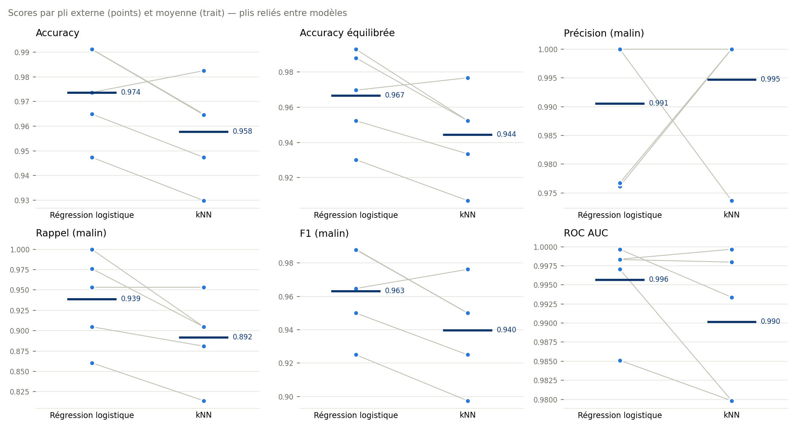

# classifier-benchmark

Étude comparative de classifieurs supervisés sur un protocole d'évaluation unifié,
appliqué au jeu de données Breast Cancer Wisconsin (scikit-learn).

## Protocole

- Classe positive : tumeur **maligne** (212 malins, 357 bénins).
- Validation croisée **imbriquée** :
  - boucle externe stratifiée (5 plis), générée une fois avec une graine fixe et
    enregistrée dans `results/splits.json` : tous les modèles sont évalués sur
    exactement les mêmes découpages ;
  - boucle interne stratifiée (5 plis) sur la seule partie entraînement de
    chaque pli externe, pour régler les hyperparamètres (critère : ROC AUC).
- Prétraitement (normalisation) inclus dans le pipeline : réappris à chaque pli.
- Métriques : accuracy, accuracy équilibrée, précision, rappel, F1, ROC AUC.

Paramètres du protocole : `src/benchmark/config.py`.
Modèles et grilles d'hyperparamètres : `src/benchmark/models.py`.

## Utilisation

```bash
pip install -r requirements.txt -r requirements-dev.txt
python scripts/run_benchmark.py                # tous les modèles
python scripts/run_benchmark.py --models knn   # un seul modèle
python -m pytest                               # tests du protocole
```

Sorties brutes (non versionnées) dans `results/`, synthèse et figures
(versionnées) dans `reports/`.

## Résultats

Modèles évalués à ce stade : régression logistique (référence) et kNN.
Tableau complet : [`reports/summary.md`](reports/summary.md).


